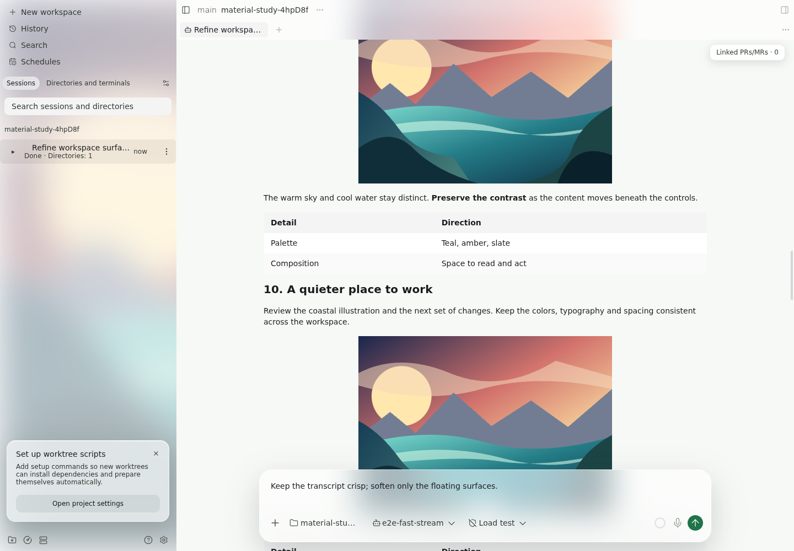
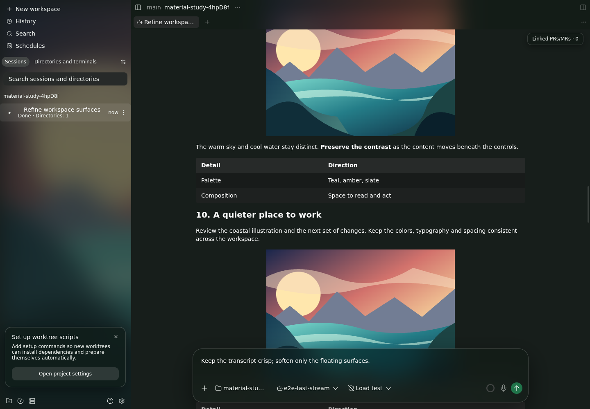

# Desktop material study — Contract v3

Choose a visible material direction before production integration. This Draft PR keeps the renderer opt-in and the sidebar row structure owned by WORK-396. The recommended starting point is **balanced / 中等**: the wallpaper and moving illustration remain visible through the tint, while pronounced / 明显 deliberately exposes more color.

**Every screenshot is the real App in Chromium. macOS vibrancy is 模拟 (simulated) in the workspace comparison: an authored coastal wallpaper is blurred behind the window. The CSS backdrop blur over the transcript is real.** The 390px captures are responsive Web. Linux uses **DejaVu Sans**, with **Noto Sans CJK SC** for the Chinese strength labels; these are not SF Pro.

## Compare the strengths

All four columns use the same content, viewport and reading position. The artwork contains a bright sun, warm sky, teal water and dark foreground so material strength is visible. Geometry assertions require an image to overlap both the header and composer by more than 15px in the pronounced desktop capture.

| Theme       | Original                                    | Restrained / 克制                              | Balanced / 中等 — recommended                | Pronounced / 明显                              |
| ----------- | ------------------------------------------- | ---------------------------------------------- | -------------------------------------------- | ---------------------------------------------- |
| Light, 1440 | [before](light-1440-conversation-solid.png) | [12px](light-1440-conversation-restrained.png) | [20px](light-1440-conversation-balanced.png) | [28px](light-1440-conversation-pronounced.png) |
| Dark, 1440  | [before](dark-1440-conversation-solid.png)  | [12px](dark-1440-conversation-restrained.png)  | [20px](dark-1440-conversation-balanced.png)  | [28px](dark-1440-conversation-pronounced.png)  |





## Detail changes

The crops are taken from the same rendered surfaces as the full screenshots and include surrounding pixels for the shadow. They are not redrawn mockups. Each change is active only in the material preview.

| Detail            | Before                                                       | After                                                                                                | Comparison                                                                                                                           |
| ----------------- | ------------------------------------------------------------ | ---------------------------------------------------------------------------------------------------- | ------------------------------------------------------------------------------------------------------------------------------------ |
| Surface hierarchy | White/zinc slabs and stacked hard rules                      | Quiet green-neutral content plane; tint separates the floating chrome; chrome dividers removed       | [chrome before](detail-light-chrome-solid.png) → [after](detail-light-chrome-balanced.png)                                           |
| Secondary strip   | Full-width “Linked PRs/MRs · 0” row displaces the transcript | 28px contextual pill at the top right; the action still expands its panel                            | [before](detail-light-secondary-solid.png) → [after](detail-light-secondary-balanced.png)                                            |
| Composer          | In-flow box, smaller padding                                 | Floating surface, 24px corners, 20px inset, shared shadow; measured bottom clearance                 | [before](detail-light-composer-solid.png) → [after](detail-light-composer-balanced.png)                                              |
| Menus/popovers    | Tight 8px container corners                                  | 16px corners, 6px outer inset, common glass tint/elevation                                           | [before](detail-light-menu-solid.png) → [after](detail-light-menu-balanced.png)                                                      |
| Dialogs           | 520px card, stronger header rule                             | 560px cap, 24px corners, softened header edge and deeper elevation                                   | [before](detail-light-dialog-solid.png) → [after](detail-light-dialog-balanced.png)                                                  |
| Banner card       | Edge-to-edge strip and high-emphasis dark CTA                | Inset 16px-radius card, 12px outer spacing, 16px inset and tonal action                              | [before](detail-light-banner-solid.png) → [after](detail-light-banner-balanced.png)                                                  |
| Icon rhythm       | Independent sizes across chrome/menu/composer                | Chrome/menu/banner glyphs 16px; composer actions 20px; 1.5px stroke                                  | [menu before](detail-light-menu-solid.png) → [after](detail-light-menu-balanced.png), [composer](detail-light-composer-balanced.png) |
| Font stack        | General system-ui stack followed by vendor fallbacks         | Preview chrome starts with `-apple-system, BlinkMacSystemFont`; then Segoe UI, Noto Sans, sans-serif | [chrome before](detail-light-chrome-solid.png) → [after](detail-light-chrome-balanced.png)                                           |

The font row records a priority change, not a claim to show SF Pro on Linux. Both system fallback routes can resolve to DejaVu Sans here. Markdown/code keep their own typography; the preview does not replace code fonts with the UI stack.

## Elevation inventory

Three levels replace per-component shadow/radius choices. Each token in `MATERIAL_PREVIEW.elevation` owns its radius, complete border, light/dark shadow and material policy. The same mapping generates the CSS. The [generated inventory](floating-inventory.json) lists **124 caller files**, their primitive and level, plus the five files deferred to WORK-396. [Regenerate it](inventory.mjs) with `node docs/qa-evidence/material-preview/inventory.mjs`; it fails if a nonstructural material slot lacks an elevation mapping.

| Level                    | Radius | Shadow, light / dark                                      | Border                    | Material                                           |
| ------------------------ | -----: | --------------------------------------------------------- | ------------------------- | -------------------------------------------------- |
| L1 hint                  |   10px | 0 4px 16px, black-green 14% / black 38%                   | 1px, dark 10% / white 16% | Protected: at least 96% opaque, blur capped at 8px |
| L2 popover               |   16px | 0 12px 36px, black-green 14% / black 38%, inner highlight | 1px white 65% / 18%       | Selected strength's glass                          |
| L3 modal / large surface |   24px | 0 20px 56px, black-green 20% / black 48%                  | 1px white 65% / 18%       | Selected strength's glass                          |

The table below names every renderer owner and its adapters. Screenshots exercise each **renderer family** with real product actions; the full caller inventory records inherited mappings without claiming a separate end-to-end run of every business dialog. Crops retain 24px of surrounding pixels so their shadows are visible.

Paths are relative to `packages/app/src/`.

| Surface / adapters                                 | Owner files                                                                                                                                                                                 | Level                                               | Rendered comparison                                                                                                                                        |
| -------------------------------------------------- | ------------------------------------------------------------------------------------------------------------------------------------------------------------------------------------------- | --------------------------------------------------- | ---------------------------------------------------------------------------------------------------------------------------------------------------------- |
| Tooltip                                            | `components/ui/tooltip.tsx`                                                                                                                                                                 | L1                                                  | [before](floating-light-tooltip-solid.png) → [after](floating-light-tooltip-balanced.png); [dark](floating-dark-tooltip-balanced.png)                      |
| Toast / copied / error / archive undo notices      | `components/toast-host.tsx`, `contexts/toast-context.tsx`, `workspace/archive-undo/internal/workspace-archived-toast.tsx`, `utils/provider-notice-toast.ts`                                 | L1                                                  | [before](floating-light-toast-solid.png) → [after](floating-light-toast-balanced.png); [dark](floating-dark-toast-balanced.png)                            |
| Dropdown / attachment “+” menu                     | `components/ui/dropdown-menu.tsx`, `components/ui/menu/menu-overlay.tsx`, `components/ui/menu/menu-surface.tsx`                                                                             | L2 wide / L3 sheet                                  | [before](detail-light-menu-solid.png) → [after](detail-light-menu-balanced.png); [compact](light-390-menu-balanced.png)                                    |
| Right-click menu                                   | `components/ui/context-menu.tsx`, same menu engine                                                                                                                                          | L2 wide / L3 sheet                                  | [before](floating-light-context-menu-solid.png) → [after](floating-light-context-menu-balanced.png); [dark](floating-dark-context-menu-balanced.png)       |
| Combobox / select / host / branch pickers          | `components/ui/combobox.tsx`, `components/ui/select-field.tsx`, `components/hosts/host-picker.tsx`, `components/branch-switcher.tsx`                                                        | L2 wide / L3 sheet                                  | Host picker [before](floating-light-combobox-solid.png) → [after](floating-light-combobox-balanced.png); [dark](floating-dark-combobox-balanced.png)       |
| Autocomplete popover                               | `components/ui/autocomplete.tsx`, `components/ui/autocomplete-popover.tsx`                                                                                                                  | L2                                                  | [before](floating-light-autocomplete-solid.png) → [after](floating-light-autocomplete-balanced.png); [dark](floating-dark-autocomplete-balanced.png)       |
| Hover card / context details                       | `components/ui/hover-card.tsx`, `components/context-window-meter.tsx`, `components/workspace-hover-card.tsx`                                                                                | L2                                                  | [before](floating-light-hover-card-solid.png) → [after](floating-light-hover-card-balanced.png); [dark](floating-dark-hover-card-balanced.png)             |
| Plugin / sidebar popover adapters                  | `plugins/popover.tsx`, `components/sidebar/sidebar-popover.tsx`                                                                                                                             | Inherit MenuSurface: L2 / L3                        | Same [menu renderer](detail-light-menu-balanced.png); plugin business actions not independently exercised                                                  |
| Generic positioned surface                         | `components/ui/floating.tsx`                                                                                                                                                                | L2 by default; explicit caller marker selects L1/L3 | [Combobox](floating-light-combobox-balanced.png), [tooltip](floating-light-tooltip-balanced.png)                                                           |
| Script setup / update / Rosetta banner             | `components/sidebar-callout.tsx`, `components/worktree-setup-callout-source.tsx`, `desktop/updates/update-callout-source.tsx`, `desktop/updates/rosetta-callout-source.tsx`                 | L2                                                  | Script card [before](detail-light-banner-solid.png) → [after](detail-light-banner-balanced.png); [dark](detail-dark-banner-balanced.png)                   |
| Archived / parent-agent composer-replacement cards | `components/archived-agent-callout.tsx`, `subagents/parent/callout.tsx`                                                                                                                     | L2                                                  | Same [card tier](detail-light-banner-balanced.png); their individual lifecycle flows are not re-run                                                        |
| Expanded linked-change panel / collapsed chip      | `agent-change-requests/section.tsx`                                                                                                                                                         | L2 / L1                                             | [before](detail-light-secondary-solid.png) → [after](detail-light-secondary-balanced.png)                                                                  |
| Adaptive dialog / form / confirmation              | `components/adaptive-modal-sheet.tsx`, `utils/confirm-dialog.ts`                                                                                                                            | L3                                                  | [before](detail-light-dialog-solid.png) → [after](detail-light-dialog-balanced.png); [dark](detail-dark-dialog-balanced.png)                               |
| Default / custom sheets                            | `components/ui/isolated-bottom-sheet-modal/index.tsx`, `material-background.web.tsx` in that directory; `SheetBackground` in adaptive-modal-sheet and `ComboboxSheetBackground` in combobox | L3                                                  | [compact menu](light-390-menu-balanced.png), [compact dialog](dark-390-dialog-balanced.png)                                                                |
| Command-center raw modal                           | `command-center/command-center.tsx`                                                                                                                                                         | L3                                                  | [before](floating-light-command-center-solid.png) → [after](floating-light-command-center-balanced.png); [dark](floating-dark-command-center-balanced.png) |
| Add-project raw modal                              | `components/add-project-flow.tsx`                                                                                                                                                           | L3                                                  | [before](floating-light-add-project-solid.png) → [after](floating-light-add-project-balanced.png); [dark](floating-dark-add-project-balanced.png)          |
| Host chooser / legacy agent action sheet           | `hosts/host-chooser.tsx`, sheet surface only in `components/agent-list.tsx`                                                                                                                 | L3                                                  | Shared [dialog](detail-light-dialog-balanced.png) / [sheet](light-390-dialog-balanced.png) renderer tier; no row structure changes                         |
| Fullscreen image / diagram viewer                  | `components/attachment-lightbox.tsx`, `components/markdown/fence/mermaid/fullscreen-viewer.web.tsx`                                                                                         | L3 frame, original viewport geometry                | Image [before](floating-light-lightbox-solid.png) → [after](floating-light-lightbox-balanced.png); [dark](floating-dark-lightbox-balanced.png)             |
| Floating composer                                  | `composer/input/presentation.tsx`, `composer/dock/index.tsx`                                                                                                                                | L3                                                  | [before](detail-light-composer-solid.png) → [after](detail-light-composer-balanced.png)                                                                    |

Portal containers, modal transports, the transcript viewport and window chrome do not paint an independent popup surface. They retain their layout roles. Top chrome uses the selected glass recipe without a popup shadow; it is not a fourth elevation level. Native Android system toasts and native media viewers remain on their existing OS paths.

**Deferred to WORK-396:** `components/left-sidebar.tsx`, `components/sidebar-workspace-list.tsx`, `session-navigation/actions.tsx`, `session-navigation/menu.tsx`, `session-navigation/sidebar.tsx` are listed as **待 WORK-396 合入后接入** in the inventory. No source change was made in those files. Shared renderer screenshots are not a claim to have completed that feature's integration. The sidebar footer's hard rule is removed through the structural-border token, not a sidebar markup edit.

## Recommended matrix and fallback

| Theme / width | Conversation                                                                                | Menu                                                                        | Dialog                                                                          | Reduced transparency                          |
| ------------- | ------------------------------------------------------------------------------------------- | --------------------------------------------------------------------------- | ------------------------------------------------------------------------------- | --------------------------------------------- |
| Light 1440    | [before](light-1440-conversation-solid.png) → [after](light-1440-conversation-balanced.png) | [before](light-1440-menu-solid.png) → [after](light-1440-menu-balanced.png) | [before](light-1440-dialog-solid.png) → [after](light-1440-dialog-balanced.png) | [opaque](light-1440-reduced-transparency.png) |
| Dark 1440     | [before](dark-1440-conversation-solid.png) → [after](dark-1440-conversation-balanced.png)   | [before](dark-1440-menu-solid.png) → [after](dark-1440-menu-balanced.png)   | [before](dark-1440-dialog-solid.png) → [after](dark-1440-dialog-balanced.png)   | [opaque](dark-1440-reduced-transparency.png)  |
| Light 390     | [before](light-390-conversation-solid.png) → [after](light-390-conversation-balanced.png)   | [before](light-390-menu-solid.png) → [after](light-390-menu-balanced.png)   | [before](light-390-dialog-solid.png) → [after](light-390-dialog-balanced.png)   | [opaque](light-390-reduced-transparency.png)  |
| Dark 390      | [before](dark-390-conversation-solid.png) → [after](dark-390-conversation-balanced.png)     | [before](dark-390-menu-solid.png) → [after](dark-390-menu-balanced.png)     | [before](dark-390-dialog-solid.png) → [after](dark-390-dialog-balanced.png)     | [opaque](dark-390-reduced-transparency.png)   |

The “before” column also shows the default non-macOS opaque fallback. Non-Mac desktop never enables native vibrancy. Explicit Web preview can still show CSS glass. Reduced transparency removes blur and transparent window layers while retaining the preview's layout and geometry. The four fallback images capture a settled open dialog, not a closing animation.

## Tokens and contrast

`MATERIAL_PREVIEW` in `packages/app/src/styles/theme.ts` owns the values. `material-preview.web.tsx` generates the opt-in CSS and provides the [strength selector](switch-light.png). No row has its own backdrop filter.

| Strength   | Floating opacity | Sidebar opacity | Blur | Saturation |
| ---------- | ---------------: | --------------: | ---: | ---------: |
| Restrained |              86% |             82% | 12px |       1.12 |
| Balanced   |              76% |             74% | 20px |       1.30 |
| Pronounced |              64% |             64% | 28px |       1.50 |

| Shared token                               | Value                                                                                 |
| ------------------------------------------ | ------------------------------------------------------------------------------------- |
| Glass base, light / dark                   | #ffffff / #121a16                                                                     |
| Content plane, light / dark                | #f7f9f6 / #171e1b                                                                     |
| Secondary text, light / dark               | #303a33 / #f0f4f1                                                                     |
| Success / danger / warning / merged, light | #16331f / #571d18 / #3f2b11 / #3b225b                                                 |
| Success / danger / warning / merged, dark  | #e6ffef / #fff1ee / #fff5e5 / #faf3ff                                                 |
| Radius: composer / menu / dialog / banner  | 24 / 16 / 24 / 16px                                                                   |
| Inset: composer / menu / banner            | 20 / 6 / 16px; banner outer spacing 12px                                              |
| Icons: chrome / primary actions            | 16 / 20px, 1.5px stroke                                                               |
| Border light / dark                        | white 65% / white 18%                                                                 |
| Small elevation light / dark               | 0 12px 36px black-green 14% / black 38%, plus inner highlight                         |
| Dialog elevation light / dark              | 0 20px 56px black-green 20% / black 48%                                               |
| Motion                                     | 160ms cubic-bezier(0.2,0,0,1), preview timing applies only when reduced motion is off |

The same tint serves composer, menus, popovers, dialogs and compact Web sheets. Headers use it without an outer shadow. Banner cards use L2; hints and toasts use the protected L1 recipe. The content plane remains opaque. Hover, pressed and selected fills retain the existing semantic interaction tokens; the sidebar rows themselves are unchanged.

[Contrast source](contrast.mjs) reads the current literal tokens from theme.ts. [Raw results](contrast.json) composite each opacity over worst-case black in light mode and white in dark mode, then apply the WCAG sRGB relative-luminance formula. The calculation covers body, secondary and four semantic text colors on both floating and sidebar glass. Lowest ratios across those roles/surfaces:

| Strength   |  Light |   Dark |
| ---------- | -----: | -----: |
| Restrained | 7.74:1 | 9.10:1 |
| Balanced   | 6.26:1 | 6.81:1 |
| Pronounced | 4.69:1 | 4.79:1 |

## Native code evidence

The current contract uses code evidence instead of native screenshots. The native `material-preview.tsx` returns null; all CSS and preview controls live in `.web.tsx`. The base `sidebar-material-color.ts` returns each supplied color unchanged, including status and structural-border helpers. [The executable passthrough check](native-code.txt) verifies this. `composer/dock/index.native.tsx` and `composer/dock/internal/background.native.tsx` are identical to main `b60da86b`.

Shared components receive stable `dataSet` markers only. Position, blur, spacing and font changes are CSS rules and do not enter native styles. The added chrome measurement's DOM write is guarded by `isWeb`; the existing width measurement is unchanged. The new native sheet-background export is undefined, so Gorhom keeps its original renderer; explicit caller components and null are preserved. Only the Web adapter adds a material marker to the default sheet background. No native blur package or dependency was added. This is code evidence, not a claim that a native device test ran.

## Reproduce

Build dependencies with `npm ci` and `npm run build:server`. In renderer DevTools set `localStorage.setItem("paseo:material-preview", "balanced")` and reload. Use the four-button selector to switch between original and the three strengths. Remove the key and reload to disable the study.

On Mac, launch with `PASEO_MATERIAL_PREVIEW=1 npm run dev:desktop` and enable the renderer key. The main window uses sidebar vibrancy, follows activation, and restores the latest opaque chrome color on `nativeTheme.prefersReducedTransparency` changes.

```sh
E2E_GPU_COMPOSITING=1 PASEO_MATERIAL_QA=1 E2E_WORKERS=1 npm run test:e2e --workspace=@getpaseo/app -- material-preview.spec.ts
node docs/qa-evidence/material-preview/contrast.mjs
```

Use installed Chromium or set `E2E_CHROMIUM_EXECUTABLE_PATH`. This run uses Chromium 140 / headless-shell 1187 with ANGLE/SwiftShader. GPU compositing is asserted enabled; default headless Linux can report the CSS property without actually painting blur. Video and trace recording are disabled for the measurement. Finish clean builds before starting Metro.

The independent evidence spec serves the authored [wallpaper](wallpaper.svg) to the real Markdown renderer. The sidebar background uses a 32px blurred copy to simulate native wallpaper sampling. The transcript images stay sharp until they scroll under a surface. Tests own and stop an isolated daemon; they never restart port 6767.

## Scroll measurement

[Frames](frames.json), [paint properties](paint.json) and [environment](environment.json) are the raw evidence. Each strength has three paired blur-off/on trials, alternating order. Only backdrop-filter changes within a pair; tint, layout, shadows and wallpaper stay constant. The workload is 18 Markdown sections with illustrations, paragraphs and tables at 1440×1000, DPR 1.

Each trial uses real wheel input to leave follow mode, resets to 30% of scroll height, then advances 12px per animation frame and reverses after 90 frames. It records 180 frames and discards the first 30 intervals. Samples include actual scroll positions and the effective filter; assertions require more than 60 distinct positions and the expected filter state. Per strength, each mode retains 450 intervals.

This measures requestAnimationFrame cadence and synchronous scroll writes, not GPU execution time or compositor presentation. It uses a shared Linux VM and software GPU. Do not compare directly with v1's text-only workload, and do not treat a steady cadence as proof that blur has no cost on Mac.

| Strength   | Blur | Intervals |   Median |      P95 |  Maximum |
| ---------- | ---- | --------: | -------: | -------: | -------: |
| restrained | off  |       450 | 16.70 ms | 16.80 ms | 50.00 ms |
| restrained | on   |       450 | 16.70 ms | 16.70 ms | 16.80 ms |
| balanced   | off  |       450 | 16.70 ms | 16.80 ms | 16.80 ms |
| balanced   | on   |       450 | 16.70 ms | 16.70 ms | 16.80 ms |
| pronounced | off  |       450 | 16.70 ms | 16.70 ms | 16.80 ms |
| pronounced | on   |       450 | 16.70 ms | 16.80 ms | 16.80 ms |

All trials passed the scroll-position and effective-filter assertions. The current workload stayed near the 60Hz requestAnimationFrame period; the scheduler quantization cannot establish a zero GPU cost. The recommendation is visual, pending a Mac presentation-time measurement.

## Verification and Mac follow-up

The v1 desktop main/window configuration is unchanged. Its full Linux unpacked desktop build remains applicable; this revision rebuilds main and runs the full workspace typecheck/lint plus the new evidence spec. No independent review is required by v3. Self-review: the opt-in CSS layer is suitable for this comparison; production integration remains a later phase after approval and WORK-396.

| Check                                  | Result                                                                    | Evidence                                              |
| -------------------------------------- | ------------------------------------------------------------------------- | ----------------------------------------------------- |
| Visual/scroll spec                     | Passed; 32 full captures, 24 detail crops, two selectors, 2,700 intervals | [browser](browser.txt), [frames](frames.json)         |
| Floating catalog                       | Passed; nine renderer families, 36 light/dark before/after crops          | [catalog](floating-browser.txt)                       |
| Sheet host regression                  | Passed; 6 tests                                                           | [sheet tests](sheet-tests.txt)                        |
| Full workspace typecheck               | Passed for v3                                                             | [typecheck](typecheck.txt)                            |
| Full workspace lint                    | Passed, no warnings                                                       | [lint](lint.txt)                                      |
| Desktop main build                     | Passed                                                                    | [main](build-main.txt)                                |
| Native palette / path checks           | Passed; code evidence under v3                                            | [native](native-code.txt)                             |
| Full desktop package / 14 window tests | Reused from v1; desktop/window code unchanged                             | [build](build-desktop.txt), [tests](window-tests.txt) |
| Native Mac runtime                     | Not run; checklist below                                                  | —                                                     |

The catalog records the existing HostPicker nested-button warning from unchanged selection-row markup; [raw console records](floating-console.json) contain no uncaught page errors.

On Mac, verify real wallpaper sampling, active/inactive vibrancy, live Reduce Transparency propagation, Spaces/fullscreen, native titlebar dragging, Retina hairlines, SF Pro fallback and GPU frame timings. Those runtime claims cannot be checked on Linux. No merge, deployment or Ready transition is part of this delivery.
