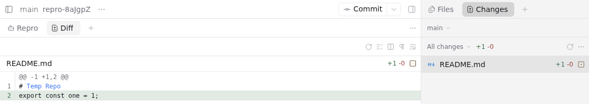
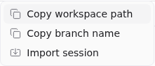
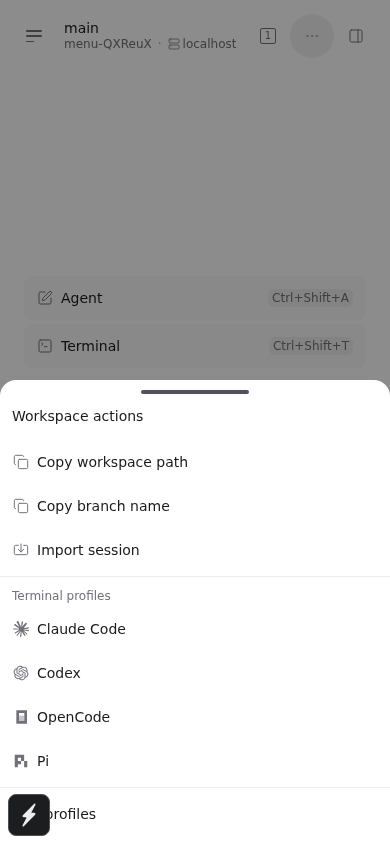

# 上游界面问题复现报告

- 基线：getpaseo/paseo `main` 5b1baa0e7（2026-11-15）。
- 环境：Linux，Chromium（Playwright `browser` 项目），本 checkout 的 daemon + Metro web，浅色主题，宽屏 1440×900、窄屏 390×844。
- 取证脚本是临时 Playwright spec，只用于截图和读 DOM，没有提交到任何分支。

| 候选             | 上游 bug | 结论                                                                | 分支                              |
| ---------------- | -------- | ------------------------------------------------------------------- | --------------------------------- |
| #8 diff 面板头部 | 否       | 上游没有 fork 那段路径说明块，每层头部只有一条下边框，符合 §5       | —                                 |
| X5 焦点环        | 是       | 头部和工具栏的图标按钮键盘聚焦时 outline 为 0px                     | `upstream/icon-button-focus-ring` |
| #2 菜单图标列    | 否       | fork 独有菜单项的问题；上游混排的那一行符合 §8 的 leading rail 规则 | —                                 |
| X2 图标线宽      | 否       | 设计取舍，只出 Discussion 草稿                                      | —                                 |

## #8 diff 面板头部

- 上游的 Diff 标签只有三层：标签行、`PaneContentToolbar`、文件头。没有 “Checkout: <path>” 和 “Directory changes can include work from other sessions…” 这段居中文案；`git grep` 在上游 `packages/app/src` 里找不到这些字符串。
- 边框实测（`repro/diff-borders.json`）：标签行底边 y=72，工具栏底边 y=108，文件头底边。每一层 pane chrome 一条下边框，正是 design.md §5 写的 “single bottom border”。没有同一位置叠线。
- 结论：清单里的问题来自 fork 的会话导航层，不是上游 bug，停止此项。

## X5 焦点环

- 上游 `public/index.html` 用 `*:focus-visible` 画 2px 主题色焦点环，`plugin-theme.spec.ts` 也在测它，说明这是既定行为。
- 共享的 `icon-button-chrome.ts` 在三种尺寸上都写了 `outlineWidth: 0`，Unistyles 的类覆盖了全局规则。
- 键盘 Tab 遍历实测（`repro/focus-report.json`）：所有元素都命中 `:focus-visible`，但 `menu-button`、`workspace-header-menu-trigger`、`workspace-explorer-toggle`、`workspace-new-tab-button`、`workspace-split-pane-menu` 的 outline 是 `solid 0px`，其余按钮、标签、侧栏行都是 `solid 2px`。
- 能写出修复前失败的测试：`icon-button-focus-ring.spec.ts` 在上游 main 上失败（Expected "2px"，Received "0px"），修复后通过。
- 修复时发现外扩 2px 的环会被头部标题行的 `overflow: hidden` 截掉上下边，所以改为内嵌（`outlineOffset: -2`），见 PR 草稿。

清单里另外列了 26 处重置，其余位置（菜单行、输入框、composer、搜索框）有行高亮、光标或边框表示焦点，不在本次范围；要统一成一个焦点 token 属于设计改动，不适合当 bug 修。

## #2 菜单图标列

- 清单举的例子 `Link PR/MR`、`+ Bind directory`、`New worktree`、`Session settings` 在上游都不存在（`directory-toolbar.tsx` 和会话菜单是 fork 独有）。
- 上游桌面端工作区 `⋯` 菜单三项都有图标，文字对齐：

  

- 上游窄屏工作区菜单里唯一不带图标的是独立分组里的 “Edit profiles”，文字左缘 x=13，与其他行的图标左缘对齐，带图标行的文字在 x=37（`repro/compact-workspace-menu-rails.json`）：

  

- design.md §8 写的是 “A row whose icon is absent still starts its title on the leading rail”，leading rail 是图标左缘；docs/menus.md 也说根菜单行可以不带图标。上游这一行符合现行规则，不是可复现的 bug，停止此项。是否要求 “同一菜单一律带图标” 属于设计讨论。

## X2 图标线宽

评估和 Discussion 草稿见 [x2-icon-stroke-discussion.md](x2-icon-stroke-discussion.md)。
