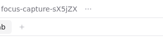
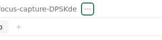
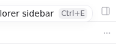
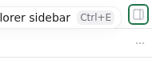

<!-- Title: fix(app): show the keyboard focus ring on icon buttons -->
<!-- Branch: upstream/icon-button-focus-ring, one commit on main 5b1baa0e7. Upload the four PNGs in this directory where the image placeholders are. -->

### Linked issue

None. Reproduced on `main` at 5b1baa0e7.

### Type of change

- [x] Bug fix
- [ ] New feature
- [ ] Enhancement
- [ ] Refactor
- [ ] Docs

### Reasoning

Keyboard users cannot see where focus is when it lands on an icon-only button in the workspace header or a pane toolbar. `public/index.html` draws a themed ring for `:focus-visible`, but the shared icon button chrome (`packages/app/src/components/ui/icon-button-chrome.ts`) sets `outlineWidth: 0` on all three frames, and Unistyles' class wins over the global `*:focus-visible` rule. The button matches `:focus-visible`, the computed outline is `solid 0px`, and nothing is drawn.

Affected buttons are every consumer of `iconButtonChromeStyle`: the sidebar toggle, the workspace actions `⋯`, the Explorer toggle, the new-tab `+`, the pane `⋯` menu, the diff toolbar buttons and plugin header buttons. Text buttons, tabs and sidebar rows already show the ring.

The fix removes the reset and sets `outlineOffset: -2` on the frame, so the ring is drawn inside the button. An outset ring is clipped: the header title row has `overflow: hidden` at the button's height, so the `⋯` button lost the top and bottom edges of a 2px-offset ring. Pointer focus stays unringed through the existing `*:focus { outline: none }` rule.

### Goals

- Header and toolbar icon buttons show the same themed `:focus-visible` ring as the rest of the app.
- The ring is not clipped by the rows these buttons sit in.
- Mouse clicks still do not draw a ring.

### Non-goals

- The other local outline resets (menu rows, inputs, the composer, search fields). Those surfaces show focus another way (row highlight, caret, border) and are out of scope.
- Changing the ring token, colour or width in `public/index.html`.
- Native platforms. Native does not draw outlines for these buttons before or after this change.

### QA

Reproduced on browser web (Chromium, 1440×900, light theme) with the e2e harness: daemon plus Metro web from this checkout, a seeded workspace, keyboard focus moved onto header buttons.

Tab order from the sidebar into the workspace header, before the fix. Every element matches `:focus-visible`; the icon buttons report a 0px outline:

```
sidebar-add-project              focusVisible=true  outline=solid 2px
sidebar-settings                 focusVisible=true  outline=solid 2px
menu-button                      focusVisible=true  outline=solid 0px
workspace-header-menu-trigger    focusVisible=true  outline=solid 0px
changes-primary-cta              focusVisible=true  outline=solid 2px
workspace-explorer-toggle        focusVisible=true  outline=solid 0px
workspace-tab-agent_…            focusVisible=true  outline=solid 2px
workspace-new-tab-button         focusVisible=true  outline=solid 0px
workspace-split-pane-menu        focusVisible=true  outline=solid 0px
```

The same walk after the fix: all 25 stops, including the five icon buttons above, report `outline=solid 2px`.

Keyboard focus on the workspace actions `⋯`:

| Before                                              | After                                             |
| --------------------------------------------------- | ------------------------------------------------- |
|  |  |

Keyboard focus on the Explorer toggle (its tooltip opens on focus in both):

| Before                                          | After                                         |
| ----------------------------------------------- | --------------------------------------------- |
|  |  |

Regression test `packages/app/e2e/browser/icon-button-focus-ring.spec.ts` focuses the workspace actions `⋯` and the Explorer toggle after keyboard input and asserts a solid 2px ring with a -2px offset, then clicks the Explorer toggle and asserts no ring.

Without the fix:

```
$ cd packages/app && npx playwright test --project=browser e2e/browser/icon-button-focus-ring.spec.ts
Running 1 test using 1 worker
  ✘  1 [browser] › e2e/browser/icon-button-focus-ring.spec.ts:42:7 › Icon button focus ring › header icon buttons show the focus ring for keyboard focus only (18.8s)
    Error: expect(locator).toHaveCSS(expected) failed
    Locator:  getByTestId('workspace-header-menu-trigger').filter({ visible: true }).first()
    Expected: "2px"
    Received: "0px"
  1 failed
```

With the fix:

```
$ cd packages/app && npx playwright test --project=browser e2e/browser/icon-button-focus-ring.spec.ts
Running 1 test using 1 worker
  ✓  1 [browser] › e2e/browser/icon-button-focus-ring.spec.ts:42:7 › Icon button focus ring › header icon buttons show the focus ring for keyboard focus only (9.0s)
  1 passed (33.4s)
```

Checks:

```
$ npm run typecheck   # exit 0
$ npm run lint        # Found 0 warnings and 0 errors.
$ npm run format:check
All matched files use the correct format.
```

| Platform        | Tested | Notes                                                               |
| --------------- | ------ | ------------------------------------------------------------------- |
| iOS             | No     | Style change only affects web outline; native draws no outline here |
| Android         | No     | Same as iOS                                                         |
| Web             | Yes    | Chromium on Linux, e2e harness, light theme                         |
| Desktop macOS   | No     | Same renderer as web; not run                                       |
| Desktop Windows | No     | Not run                                                             |
| Desktop Linux   | No     | Electron not run; browser web covers the same CSS                   |

### Checklist

- [ ] Plugin changes follow the [SDK import boundaries](../docs/plugins.md#sdk-import-boundaries) (if applicable)
- [x] One focused change
- [x] `npm run typecheck` passes
- [x] `npm run lint` passes
- [x] `npm run format` passes
- [x] QA evidence
- [x] Tests added or updated where it made sense
