# Polish inventory — WORK-419

Inventory only; nothing here is implemented in this branch. Captures are from main `8400a809`, web, light, 1440×900 unless noted, taken by the `polish walkthrough` case in `packages/app/e2e/browser/window-skeleton-capture.spec.ts`.

Priority:

- **P0** — visibly broken or inconsistent on a primary surface; cheap to fix.
- **P1** — the main inconsistency left once the skeleton lands; needs a small design decision.
- **P2** — refinement or a dev-only artifact.

"Depends on design.md" names the new rule the fix applies. "No" means the existing rules already cover it.

| #   | Surface                       | Priority | Depends on design.md    |
| --- | ----------------------------- | -------- | ----------------------- |
| 1   | Two-row workspace header      | P1       | §14 window skeleton     |
| 2   | Menu items without icons      | P0       | No (§8 alignment)       |
| 3   | Sidebar top navigation        | P1       | §15 layers              |
| 4   | Motion coverage               | P1       | §15 (motion row to add) |
| 5   | Empty main area               | P2       | No (§11 states)         |
| 6   | Pill row over the transcript  | P0       | §15 layers              |
| 7   | Bottom-left floating badge    | P2       | No                      |
| 8   | Diff panel header noise       | P0       | No (§5 borders, §11)    |
| 9   | Directory selector row        | P1       | §14 window skeleton     |
| 10  | Explorer inside the panel     | P1       | §14 window skeleton     |
| 11  | Top rail jumps between routes | P1       | §14 window skeleton     |
| 12  | Settings                      | P2       | §14 window skeleton     |
| 13  | New workspace composer        | P2       | §15 layers              |
| 14  | Command center                | P2       | §14 window skeleton     |
| 15  | Window-control corners        | P1       | §14 window skeleton     |

---

## 1. Two-row workspace header

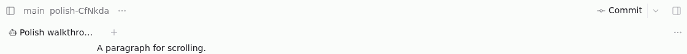

- **Now.** The workspace header is two rows on wide layouts: branch and project (`main  polish-…  ⋯`) above the tab strip. It takes about 72px before any content.
- **Problem.** The first row carries two labels and one menu, and repeats what the sidebar already highlights. With the panel floating, the double band reads as a toolbar stacked on a toolbar.
- **Proposal.** One row on wide layouts: the sidebar toggle, the tab strip, then the workspace `⋯` and Explorer toggle on the right. Branch and project move into the `⋯` menu header and the tab tooltip. Compact keeps its current header.
- **Depends on.** §14 (the panel's top edge is the header's top edge).

## 2. Menu items without icons

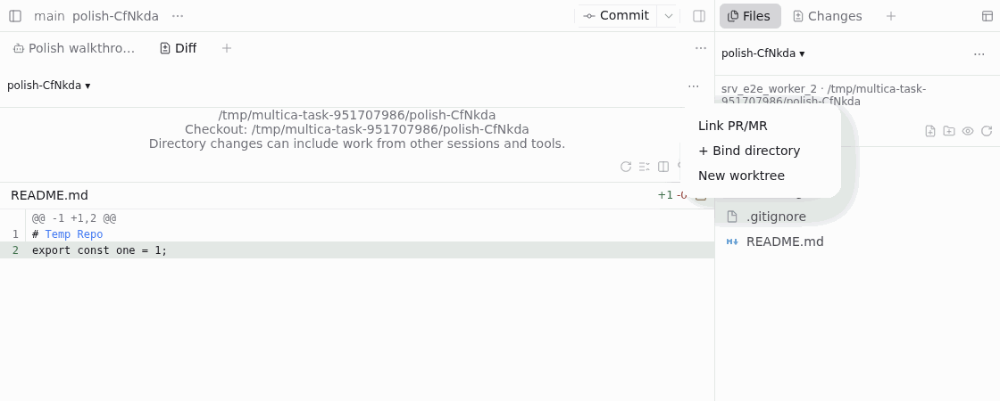

- **Now.** The directory `⋯` menu in the Diff and Files panes (`packages/app/src/session-navigation/directory-toolbar.tsx`) lists `Link PR/MR`, `+ Bind directory`, `New worktree`. Only one item has a leading mark, and it is a text `+` inside the label. The session menu has the same gap for `Link PR/MR` and `Session settings` (from the user's capture; that menu only renders with session navigation enabled, so it is not in this walkthrough).
- **Problem.** Labels start on different rails; §8 requires a row without an icon to keep its title on the leading rail, and `<DropdownMenuItem leading>` exists for this.
- **Proposal.** Give every item a `leading` icon at `iconSize.sm`, `foregroundMuted`: `Link`, `FolderPlus`, `GitBranch`, `Settings`. Drop the `+` from the label.
- **Depends on.** No.

## 3. Sidebar top navigation

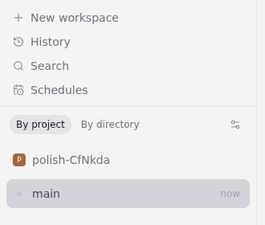

- **Now.** New workspace, History, Search and Schedules are flat text rows with muted icons; the `By project / By directory` switch is a custom pill pair; selected workspace rows already use the 12px session-row shape.
- **Problem.** Two row styles in one column: the nav rows have no hover shape matching the workspace rows below, and the switch is not `<SegmentedControl>`.
- **Proposal.** Nav rows use the session-row inset and 12px hover shape. The switch becomes `<SegmentedControl size="sm">`. Both sit on the floor material with no fill of their own.
- **Depends on.** §15 (sidebar content sits on the floor; only selection and hover add fill).

## 4. Motion coverage

- **Now.** `MATERIAL.motion` (160ms) is used for one thing: the composer border transition (`packages/app/src/styles/materials.web.tsx`). Menus have an entering animation from `menu-overlay.tsx`. The docked sidebar hides with `display: none` (`packages/app/src/mobile-panels/presentation.tsx`), so collapse is instant. Dialogs, tooltips and the Explorer have no shared timing.
- **Problem.** Some surfaces animate and some jump, with unrelated curves.
- **Proposal.** Add a motion row to §15: L1 fade 120ms, L2 fade and 98% scale 160ms, L3 fade and 4px rise 200ms, sidebar width 200ms, all `MATERIAL.motion.easing` and off under `prefers-reduced-motion`. Sidebar collapse needs a width animation instead of `display: none`.
- **Depends on.** §15, plus the new motion row.

## 5. Empty main area

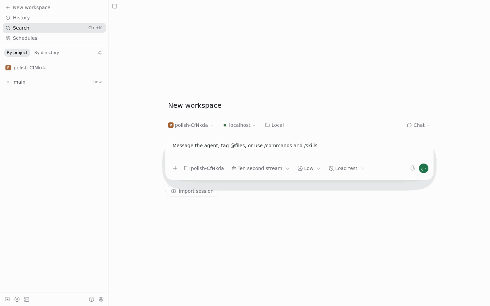

- **Now.** A new workspace is a title, a picker row and a composer at the top third of an empty panel. A new agent tab is an empty transcript with only the composer.
- **Problem.** Nothing tells the user what happens next; most of the panel is blank.
- **Proposal.** A quiet §11 empty state above the composer: one muted line and at most one ghost action (for example "Import session"), no illustration.
- **Depends on.** No.

## 6. Pill row over the transcript

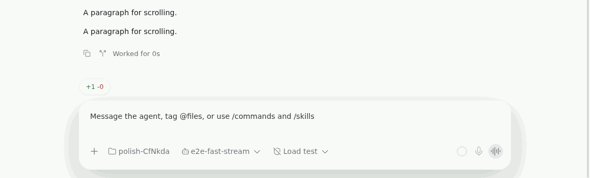

- **Now.** The diff-stat pill (`+1 -0`) floats above the composer with no fill; transcript text scrolls behind it.
- **Problem.** Text shows through and the pill reads as part of the transcript.
- **Proposal.** Move the pill row into the composer's L3 glass as its top track, or give each pill the L1 material. Prefer the former: one floating object instead of two.
- **Depends on.** §15 (glass is for floating; a floating control belongs to a layer).

## 7. Bottom-left floating badge

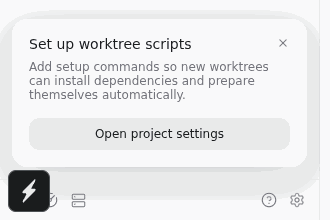

- **Now.** A dark lightning badge sits over the sidebar footer icons at 10px from the left, 6px from the bottom.
- **Finding.** It is the Expo LogBox error toast (`@expo/log-box` `ErrorToast`, rendered in a shadow root `#error-toast`), installed only when `NODE_ENV === "development"` on web. Packaged desktop and production web never show it. It appears once the dev session logs problems; this run logged `DraftStore` fetch failures and desktop update checks against the e2e daemon.
- **Proposal.** No product change. Optional: silence the two known noisy dev logs so the toast means something.
- **Depends on.** No.

## 8. Diff panel header noise

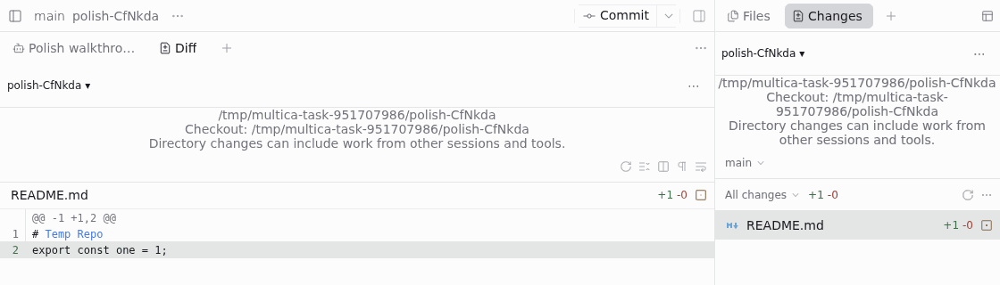

- **Now.** Above the diff, three centered lines repeat the path: the directory, `Checkout: <path>`, and "Directory changes can include work from other sessions and tools." The Changes pane in the Explorer repeats the same block.
- **Problem.** Raw paths in the content area, twice, centered, pushing the diff down. §11 asks for states at the smallest scope, and the hint is persistent.
- **Proposal.** One muted `sm` line in the directory selector's tooltip, shown only when the directory differs from the workspace. Remove the block from both panes.
- **Depends on.** No.

## 9. Directory selector row

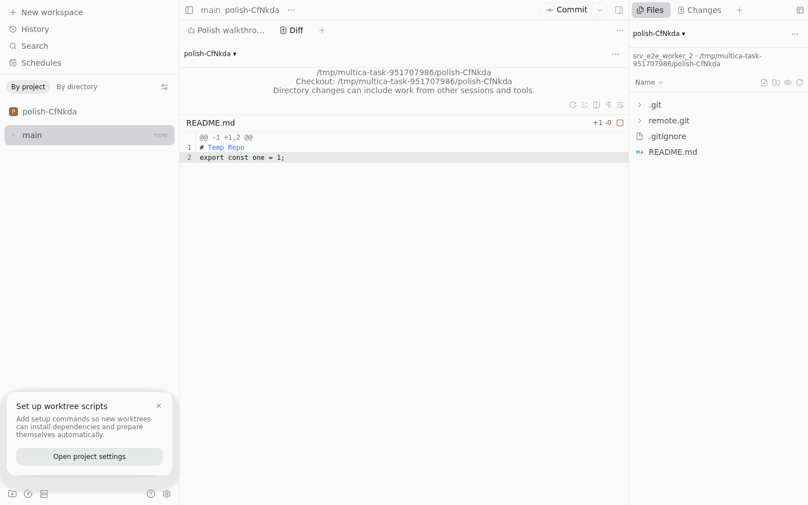

- **Now.** The Diff tab and the Files pane each add their own row with `polish-… ▾` (a text triangle, not the chevron icon used elsewhere) and a `⋯`. With the two-row header this is a third band before content.
- **Problem.** A third header band and a fourth chevron style.
- **Proposal.** Fold the selector into the pane chrome row as a `<DropdownMenu>` trigger with `ChevronDown`. Pairs with item 1.
- **Depends on.** §14.

## 10. Explorer inside the panel

- **Now** (see item 9 capture). The Explorer is a `surfaceSidebar` column inside the panel, with its own left border.
- **Problem.** Under the skeleton the window shows three materials: floor, panel, and a sidebar-coloured column inside the panel.
- **Proposal.** Either the Explorer takes the panel's content fill and a hairline divider, or it becomes its own floating panel on the floor with the same 8px gap. The second matches §14 better and makes the Explorer toggle symmetric with the sidebar toggle.
- **Depends on.** §14 (needs a decision recorded there).

## 11. Top rail jumps between routes

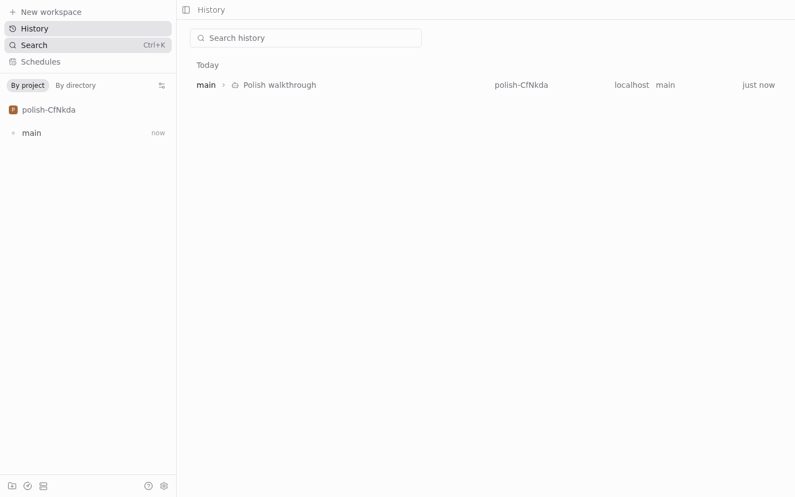 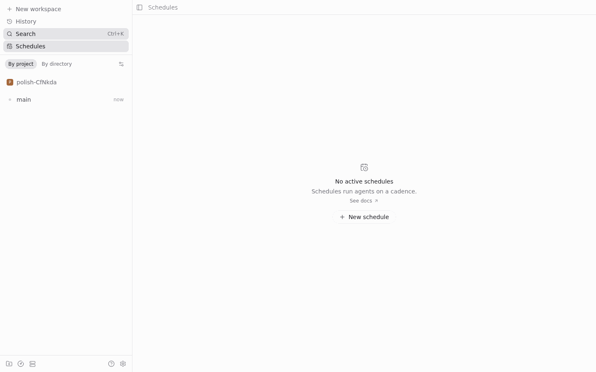

- **Now.** History and Schedules have a single 36px header; the workspace has the 72px two-row header; Settings has none.
- **Problem.** Switching routes moves the content's top edge.
- **Proposal.** One header height for every route inside the panel, settled with item 1.
- **Depends on.** §14.

## 12. Settings

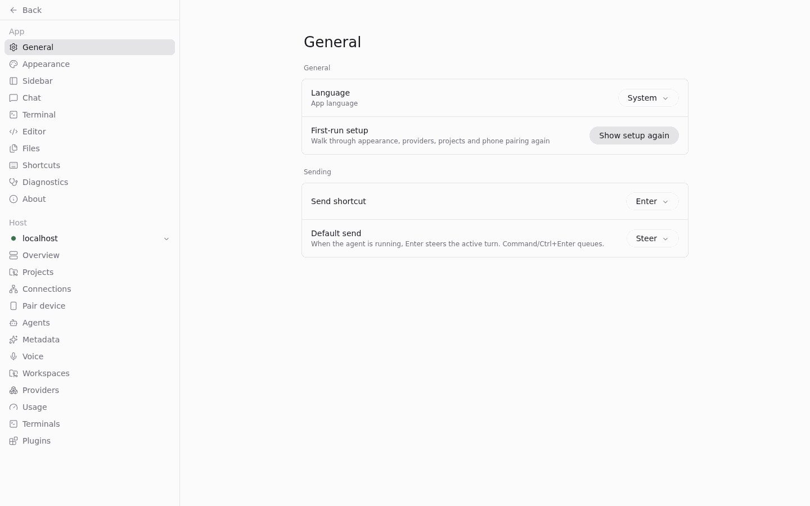

- **Now.** Settings replaces the app sidebar with its own list, which now sits on the floor; the detail is the panel. Layout follows the list+detail shell.
- **Problem.** Minor: the detail has no header row, unlike every other route (item 11).
- **Proposal.** Add a `<ScreenHeader>` row with the section title at the shared height; leave the list on the floor.
- **Depends on.** §14.

## 13. New workspace composer

See item 5 capture.

- **Now.** The composer keeps its L3 glass, border and large shadow on the New workspace page, where nothing scrolls under it.
- **Problem.** §15 reserves glass for surfaces over moving content; here it is a heavy card on a still page.
- **Proposal.** On New workspace, render the composer at L3 radius with the hairline border and no blur or large shadow.
- **Depends on.** §15.

## 14. Command center

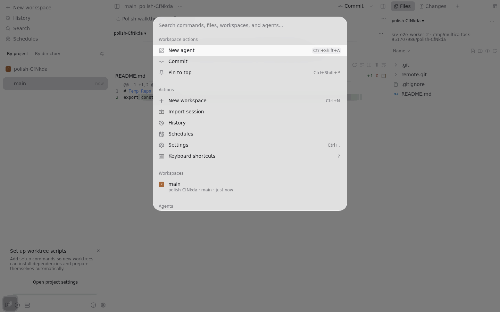

- **Now.** The command center is an L3 dialog centered on the window, over a scrim that also dims the sidebar callout and floor.
- **Problem.** Works. With the panel, centering on the window rather than the panel looks offset when the sidebar is open.
- **Proposal.** Keep window centering (the command center is global), but check the scrim on real macOS: dimming vibrancy may look muddy.
- **Depends on.** §14.

## 15. Window-control corners

- **Now.** The skeleton moves the panel's top edge down 8px. On macOS the collapsed-sidebar header now starts 8px lower, next to the traffic lights. On Windows and Linux the custom window controls sit over the top-right of the panel.
- **Problem.** Not verified on real desktops; the traffic-light offset (`trafficLightOffsetY`) and custom control placement were tuned for a flush header.
- **Proposal.** Verify on real macOS, Windows and Linux; adjust `trafficLightOffsetY` and the custom controls to the panel inset if they look off-center.
- **Depends on.** §14.

### Compact reference

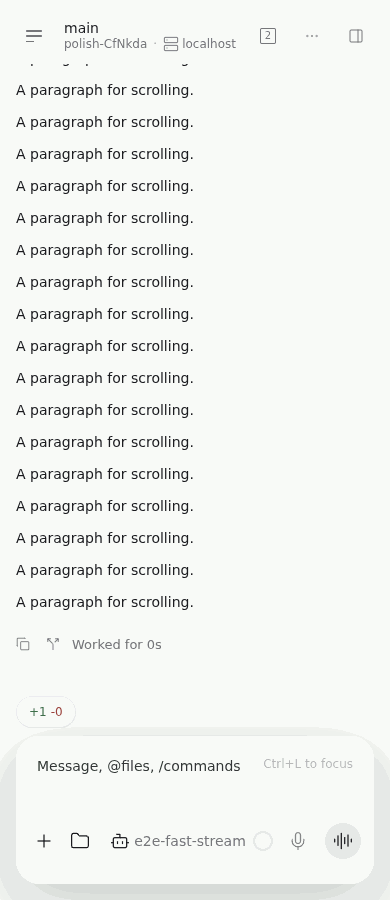

The 390px layout is unchanged by the skeleton. Items 1, 6 and 8 also apply there; the rest are wide-only.

---

## Precision gaps against Xcode

Xcode on macOS 26 is the reference for finish, not for layout or look. Each row names a measurable gap; "Mac" marks items that need a real Mac to judge, because Linux Chromium renders DejaVu Sans instead of SF Pro and has no native focus ring or vibrancy.

| #   | Aspect                  | Xcode                                                                                                    | Paseo now                                                                                                                                                                                                            | Proposal                                                                                                                                               | Priority | Mac |
| --- | ----------------------- | -------------------------------------------------------------------------------------------------------- | -------------------------------------------------------------------------------------------------------------------------------------------------------------------------------------------------------------------- | ------------------------------------------------------------------------------------------------------------------------------------------------------ | -------- | --- |
| X1  | Type scale and weight   | SF Pro at 13pt body / 11pt secondary; sidebar section headers 11pt semibold muted                        | 14px base, 12px `sm`, weights 300/400/500 (§3). The material font stack falls back to DejaVu on Linux. Sidebar section labels ("By project") are pills, not headers                                                  | On macOS desktop, evaluate a 13px base with SF Pro and `-apple-system` optical sizes; keep §3's tiers. Decide after a Mac capture at both sizes        | P1       | Yes |
| X2  | Icon stroke consistency | SF Symbols, one weight matched to the adjacent text weight                                               | Lucide at mixed strokes: `strokeWidth` 2.2 ×13, 2.5 ×7, 1.5 ×7, 2.4 ×3, 3, 2 and 1.25 once each in `.tsx`, plus the default 2 everywhere unset. `MATERIAL.icon.stroke` forces 1.5 only inside material slots via CSS | One stroke per icon size, owned by a token (1.5 at 16px, 1.75 at 14px), set on a shared icon wrapper rather than per call site. Remove literal strokes | P1       | No  |
| X3  | Row height and grid     | Rows on a 4pt grid; sidebar rows 24–28pt; disclosure, icon and label on fixed columns                    | Sidebar nav rows, workspace rows and project rows use different heights and leading insets (item 3); diff and file rows use their own                                                                                | One sidebar row height per density, one leading icon column shared by nav, project and workspace rows; check with an overlay grid                      | P1       | No  |
| X4  | Selected state          | Selection is a rounded accent-tinted fill; the label stays primary; inactive windows desaturate the tint | Selected workspace row is a grey `surface2` slab; tabs use a different grey; no inactive-window state                                                                                                                | One selection token for sidebar rows and tabs, a subtle accent tint; dim it when the window loses focus on desktop                                     | P2       | Yes |
| X5  | Focus ring              | System focus ring: accent, offset outside the control, follows the control's radius                      | 26 `outlineWidth: 0` / `outline: none` sites remove the browser ring; only hover cards read `:focus-visible`. Keyboard focus is often invisible                                                                      | A shared `:focus-visible` ring token (2px accent, 2px offset, inherits radius) on `ui/` primitives; delete local outline resets                        | P1       | Yes |
| X6  | Dividers                | Hairlines only where content regions meet; most grouping is spacing                                      | The sidebar still draws separators under the nav block and above the footer, the diff pane draws three stacked borders (item 8), and pane chrome adds its bottom border                                              | Keep §5 interior borders; remove sidebar separators in favour of spacing, and collapse stacked pane borders to one                                     | P2       | No  |

X2, X3 and X6 can be measured in this repository today; X1, X4 and X5 should be judged from a real Mac capture before choosing values.
